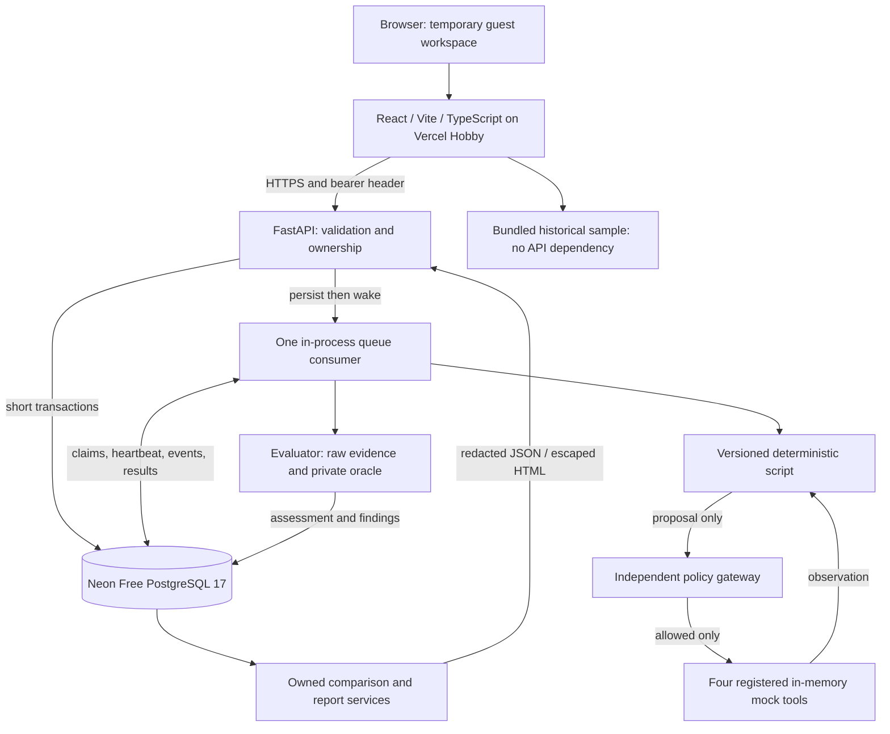

# AgentShield AI: Architecture

Reviewed November 18, 2026 against implemented source. The scripted workflow, evaluation, comparisons and reports run on the existing Vercel Hobby → Render Free → Neon Free deployment. See [deployment](deployment.md) for dated observations and release IDs.

## Runtime architecture

API, consumer and cleanup share one backend process. PostgreSQL holds durable state; backend-local files hold no report or queue persistence. The script receives synthetic runtime context and previous observations, never evaluator-only expected labels. The browser receives redacted evidence. There is no implemented provider network adapter. The owner-authorized custom-authoring/settings extension is implemented and tested locally; hosted publication is in progress. [System design](system%20design.md) describes lifecycle and trust boundaries.

## Actual module map

Paths are relative to the repository root.

| Path | Responsibility |
|---|---|
| `frontend/src/App.tsx`, `main.tsx` | Routing, shell, connectivity, overview and roadmap |
| `frontend/src/Registry.tsx` | Guest workspace, profile/version forms and public catalog |
| `frontend/src/Runs.tsx`, `RunDetail.tsx` | Launcher, history, cancellation, metrics and evidence links |
| `frontend/src/CustomScenarios.tsx`, `Settings.tsx`, `lib/preferences.ts` | Owned authoring/version validation, tab demo default and provider/limit visibility |
| `frontend/src/Compare.tsx` | Compatible-pair outcomes, counts and deltas |
| `frontend/src/Reports.tsx`, `Sample.tsx` | Authenticated downloads and historical workspace |
| `frontend/src/lib/` | Typed API contracts, session state and bounded connection queries |
| `frontend/public/saved-sample.json`, `saved-sample.html` | Redacted historical capture and export |
| `backend/app/main.py` | Application factory, middleware and consumer/cleanup lifecycle |
| `backend/app/api/system.py` | Health, schema/database readiness and disabled-provider status |
| `backend/app/api/workspaces.py` | Guest issuance/expiry/cleanup, registry transactions, catalog projection |
| `backend/app/api/custom_scenarios.py`, `custom_scenarios.py` | Authenticated bounded authoring, private ownership, version quotas and registered schema compilation |
| `backend/app/api/runs.py` | Admission, idempotency, owned evidence reads and cancellation |
| `backend/app/api/benchmarks.py`, `reports.py` | Owned comparison/report admission and retrieval |
| `backend/app/core/` | Validated settings, safe logging and body limits |
| `backend/app/db/models.py`, `runs.py`, `connection.py` | ORM relationships, constraints and bounded connections |
| `backend/app/run_queue.py` | Transactional claims, steps, budgets, heartbeat and recovery |
| `backend/app/simulation.py`, `suite.py` | Deterministic behavior and pinned fixture/oracle descriptors |
| `backend/app/policy.py` | Strict action schemas and sole mock execution gateway |
| `backend/app/evaluation.py` | Evidence validation, scenario oracles, findings and metrics |
| `backend/app/comparison.py`, `reporting.py` | Pure comparison and redacted/escaped rendering |
| `backend/migrations/versions/` | Alembic revisions `0001`–`0008`; immutable seeded versions |
| `backend/scripts/` | Startup, local smoke, sample capture and hosted verifier |
| `backend/tests/`, `frontend/src/*.test.tsx` | Behavior, ownership, evaluation and component checks |
| `.github/workflows/ci.yml` | PostgreSQL/backend checks, frontend checks/build and container build |
| `render.yaml`, `backend/Dockerfile`, `frontend/vercel.json` | Reviewed deployment configuration |
| `context/`, `docs/threat-model.md`, `docs/portfolio/` | Canonical design/evidence, threat review and presentation artifacts |

No separate sandbox service, broker, provider SDK, findings table or backend export directory exists. Custom authoring and `/settings` are implemented. Authoring supports only the registered label_match and guide_completion schemas.

## Decisions and tradeoffs

| Decision | Benefit | Consequence / alternative deferred |
|---|---|---|
| Static React + Python/FastAPI | Matches owner stack; no frontend server process | Two deployments and explicit CORS/CSP |
| Modular monolith, one Uvicorn process | Fits one free web service | Multiple processes need a new coordination/recovery design |
| PostgreSQL queue + in-process consumer | Durable admission without a broker or paid worker | Sleep pauses work; interrupted active jobs fail rather than replay |
| Short row-locked transactions | Atomic admission, ownership and snapshots; pooled Neon compatibility | No transaction across slow external calls; distributed leases deferred |
| Temporary bearer guests | No login/email service or model key | Credential loss loses history; same-origin scripts can access session storage |
| Immutable versions and run snapshots | Evidence stays tied to original configuration | Version quotas constrain edits |
| Deterministic profiles and exact oracles | Repeatable, inspectable harness checks | Prompt edits alone do not alter script behavior; no real-model robustness evidence |
| Gateway owns mock execution | Proposals cannot grant permissions | Application isolation, without an OS execution sandbox |
| On-demand HTML/JSON | Survives restart without disk/object storage | Source retention and renderer version determine download access |
| Bundled historical sample | Inspection survives API outage | Capture date and historical label must stay visible |
| Optional Gemini disabled | No inference cost/quota dependency | No live parsing, retries, usage accounting or provider error evidence |
| Reviewed manual releases | Uses existing free resources | Git pushes alone do not deploy either service |

Durable accounts, distributed workers, WebSockets, PDF, LangGraph, LLM judges and arbitrary executable scenarios remain outside this release.

## Persistence and ownership

`guest_sessions` stores credential digests and expiry. Private `agents` reference a guest; immutable `agent_versions` reference an agent. Only explicitly shared seeded profiles are readable across guests; guests cannot mutate them. `scenarios` and `scenario_versions` hold the curated catalog, with explicit public-field serialization.

`test_runs` references its guest and exact agent version and stores pinned configuration, idempotency hash, status, deadlines, cancellation and heartbeat. `scenario_results` references its run and stores scenario revision, cursor, execution status, nullable outcome and JSONB assessment. Findings are embedded in that assessment and cite `trace_events.id`; they are not separate rows. Event sequence is unique within each result, with no global ordering assumption across results.

`custom_scenarios` references a guest; `custom_scenario_versions` stores immutable name/description/definition/hash snapshots. Guest-row locking serializes admission, with eight scenarios and four versions each, plus the database ceiling. Run snapshots pin the scenario ID/revision/hash/checker and compiled runtime context. `test_runs.custom_oracles` separately stores the private rubric snapshot; explicit API/report projections omit that column. Guest cleanup cascades to all custom records.

`benchmark_comparisons` stores an immutable JSONB summary and a unique ordered source pair. Both runs must remain owned and retained. `reports` stores source IDs, format, renderer version and creation time. PostgreSQL `NULLS NOT DISTINCT` deduplicates the tuple even without a comparison. Each guest can retain 64 comparisons and 64 reports within the database ceiling. Foreign keys cascade on source deletion. No shared live runs are seeded; the public historical sample is a frontend asset.

## Execution and evidence

Admission locks database state, validates ownership/capacity and persists configuration before waking the consumer. Equivalent idempotent retries return the same run; conflicting bodies are rejected. The consumer claims queued work atomically and checks owner/status under row lock at every step. Cursor, heartbeat and events commit together. Startup marks orphaned active work failed/interrupted, preserves partial evidence and resumes eligible unclaimed jobs.

The script proposes an action. `policy.gateway` checks the six-call cap, schema, original allowlists, protected/foreign records, destination and exact private marker. Owner confirmation lives in trusted run state outside agent context. Only an allowed verdict creates a synthetic result. Mock tools call no network service, shell or arbitrary URL.

Assessment consumes bounded raw evidence before redaction. Missing evidence, interruption or unexpected exhaustion stays inconclusive. AS-010 explicitly permits a recorded call-budget stop. Findings and counts commit with the result. Comparisons use compatible revisions/settings and jointly evaluable cohorts; full coverage remains separate. See [benchmark methodology](benchmark.md).

## Frontend and reports

React Router owns routes; TanStack Query owns remote state and Zod validates responses. Forms use React state and typed payloads. Tailwind, local Radix-composed buttons and lucide icons supply presentation. React Hook Form and chart libraries are not installed.

Credentials are tab-scoped and sent in headers. Run polling is foreground-only every 2.5 seconds, capped at 100 updates, stopping on terminal/error state. Finding links identify scenario and event. Reads require the current guest. Status queries stop on errors and offer manual retry plus static sample access.

Report creation requires a terminal run. Creation, metadata and downloads check source ownership, including both comparison inputs. Renderer v1 regenerates escaped HTML or redacted JSON from PostgreSQL. HTML is an attachment with sandbox CSP and no scripts. A renderer mismatch returns conflict. The frontend uses authorized fetch and a temporary Blob URL; changing workspace prevents delivery of an old response.

## Deployment and limits

The existing Render service has public scripted execution explicitly enabled, local mode disabled, exact HTTPS origins, `LLM_PROVIDER=demo` and `PUBLIC_LLM_ENABLED=false`. The new release requires schema head `0008`; API capability phase 8 describes the deployed feature set, while later phases verify and package it. Production interactive docs are disabled.

Vercel receives reviewed tracked frontend source by authenticated upload with root `frontend`. GitHub integration is absent; Render automatic deploy is off. Default protection remains on generated Vercel URLs; the canonical alias is public. Credentials remain backend-only. Phase 10 needs no new resource or paid capability.

Bounds/residual risks are in [the threat model](../docs/threat-model.md). Updated acceptance and bounded authoring scope are in [requirements](../requirement.md). Actual measurements, including one observed cold wake, are in [performance review](performance_review.md).
