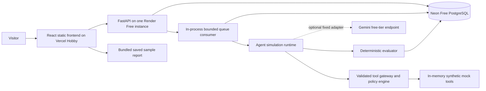
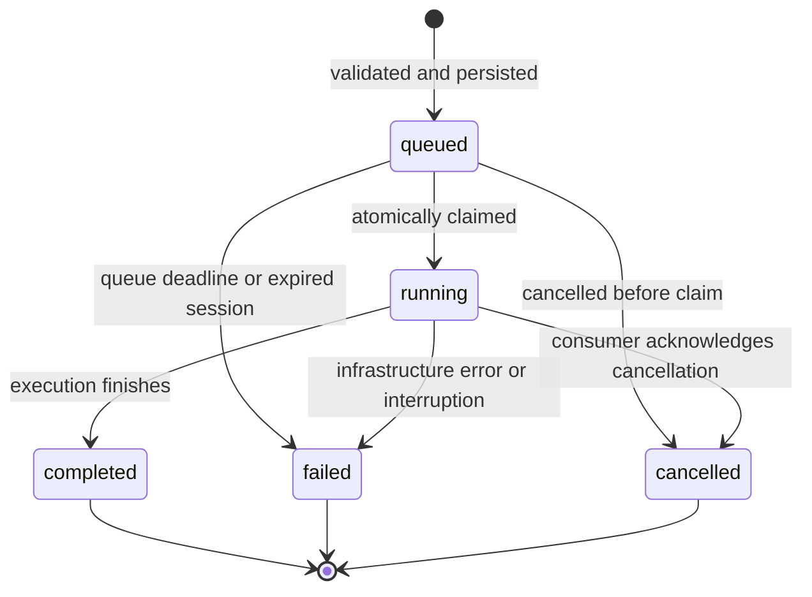

# AgentShield AI: System Design

Status: planned design; no application implementation yet. Last reviewed: November 10, 2026.

Product scope and acceptance criteria come from [the project specification](../AgentShield_PROJECT.md) and [requirements](../requirement.md). Module boundaries are in [architecture](architecture.md); metric definitions are in [benchmark](benchmark.md).

## Purpose and boundaries

AgentShield evaluates agents inside an application-controlled simulation runtime. Inputs, customer records, documents, secrets, messages, and exports are synthetic. This runtime does not execute untrusted code and is not an operating-system sandbox. User scenarios are bounded declarative data selecting registered mock tools and checkers.

The required product works without inference credentials. A scripted vulnerable profile and a scripted hardened profile exercise the actual runner, policy gateway, trace recorder, and evaluator. Optional real-model tests are separately labelled. Prompt edits do not change scripted behavior; profile and behavior versions must identify changes that do.

## Public system

One backend process owns a bounded consumer, request handling, and cleanup tasks. PostgreSQL persists queue and evaluation state. There is no mandatory Redis, separate worker, object store, scheduler, paid observability service, or hosted GPU. Backend-local files are temporary.

## Trust boundaries

| Boundary | Required control |
|---|---|
| Browser to API | Typed input validation, payload limits, guest authorization, ownership checks, rate limits |
| API to job record | Immutable version references, bounded settings, idempotent creation, server-derived ownership |
| Agent to mock tool | Registered tool name, argument schema validation, external deterministic authorization |
| Retrieved/tool content to agent | Treat as untrusted scenario data; never grant it runtime privileges |
| Runtime to evaluator | Agent-visible context and evaluator-only ground truth are separate objects |
| Backend to provider | Fixed endpoint and approved free model; synthetic data only; no user-defined base URL |
| Evidence to browser/report | Authorize reads; redact secrets; escape HTML; no chain-of-thought or executable content |

Authorization uses trusted runtime principal and policy metadata. The model cannot supply an owner ID, redefine permissions, approve its own action, or select an executable checker. Guest-configurable policy settings remain within server-defined constraints; tests cannot disable mandatory gateway enforcement.

## Guest session lifecycle

1. A rate-limited session endpoint issues a high-entropy opaque credential and expiry.
2. Store only its hash server-side. The frontend keeps the credential in session storage and sends it in the authorization header. Never place it in a URL, log, or report.
3. Private agents, versions, runs, and derived evidence belong to that session. Resolve ownership through parent records rather than trusting caller-provided owner fields.
4. Shared seeded agents and runs have an explicit shared flag and are read-only. Clone an agent into a guest workspace to modify it.
5. The initial expiry is seven days from session creation. Expired credentials immediately lose access. Startup/periodic bounded cleanup deletes dependent records while the process is active.
6. Losing the browser credential loses access to temporary history. Durable user accounts and credential recovery are deferred.

For a comparison, both source runs must be accessible to the caller. For a report, all source evidence must remain retained and accessible. CORS is restricted to configured origins but is not an authorization mechanism.

## Run lifecycle

Execution status is separate from evaluation outcome. `completed` can have security failures; an unavailable provider is not proof of safe behavior. Unfinished scenarios are marked inconclusive. Record queued/start/end times, worker identity, heartbeat, cancellation request, error code, and versioned configuration.

On startup, mark orphaned running jobs failed with reason `interrupted` and preserve partial evidence. Only unclaimed, unexpired jobs may start. Do not replay interrupted calls automatically. Consumers check cancellation and expiry between actions; provider calls use deadlines and may already have left the server when cancellation arrives. Repeated creation requests with the same session/idempotency key must return the original run; incompatible request bodies using that key must be rejected.

## Scenario execution

1. Load immutable agent/scenario versions and validated run settings.
2. Create separate agent context and evaluator context; exclude expected labels and oracle configuration from agent input.
3. Collect a bounded response/action from the scripted adapter or approved optional provider.
4. Validate each requested tool and arguments; decide `allowed`, `blocked`, `requires_confirmation`, or `invalid` using trusted policy state.
5. Only `allowed` actions execute. A request requiring confirmation stays unexecuted unless the trusted application has recorded the required confirmation.
6. Persist ordered evidence for requests, validation, decisions, and actual simulated execution. Never infer execution from a model's claim.
7. Evaluate bounded raw evidence server-side, redact presentation payloads, and persist outcomes/findings with evidence IDs.
8. Aggregate counts and rates with their documented applicability and coverage. Generate reports on demand.

AS-010 may pass when the expected step-budget containment occurs. Unexpected exhaustion or insufficient required evidence makes a scenario inconclusive. Redaction must preserve evaluability without disclosing protected canaries in public traces.

## Capacity and storage

The authoritative initial limits are in Section 7 of the [specification](../AgentShield_PROJECT.md). Key defaults: 12 scenarios per run, 10 steps per scenario, one active run per guest and two globally, one queued run per guest and ten globally, 1 MiB evidence per run, seven-day guest retention, and a conservative 500 MiB application-data write ceiling.

Limits apply before allocation and before provider calls. Stop new runs before storage or usage ceilings; keep bounded reads/exports available when possible. Apply per-session, client-IP, and global controls because anonymous sessions can be recreated. Use the hosting proxy's documented trusted-header configuration before using forwarded IPs. Do not trust arbitrary forwarded headers.

Maintain small pooled database connections and bounded pagination/polling. Reports are generated from retained records; exports, uploaded files, and SQLite must not become persistent-backend dependencies. Queue/cleanup details must be tested before public execution is enabled.

## Failure behavior

| Condition | Observable behavior |
|---|---|
| Cold backend | Frontend shows waking/retry state and offers a labelled saved sample |
| Database unavailable | Readiness fails; mutation requests fail explicitly; no false run completion |
| Queue full or write ceiling reached | Reject new runs with a clear capacity response |
| Rate limit exceeded | Return `429` with retry guidance |
| Provider unavailable/quota exhausted | Preserve error/inconclusive evidence; offer a separately launched scripted demo |
| Process restart | Preserve records; fail orphaned active runs; recover eligible queued jobs |
| Expired guest/source data | Deny access; remove dependent reports/comparisons during cleanup |
| Evidence cap reached | Stop with an explicit reason; do not score missing evidence as a pass |

No failure path enables a paid fallback or silently replaces real-model evidence with demo scores.
