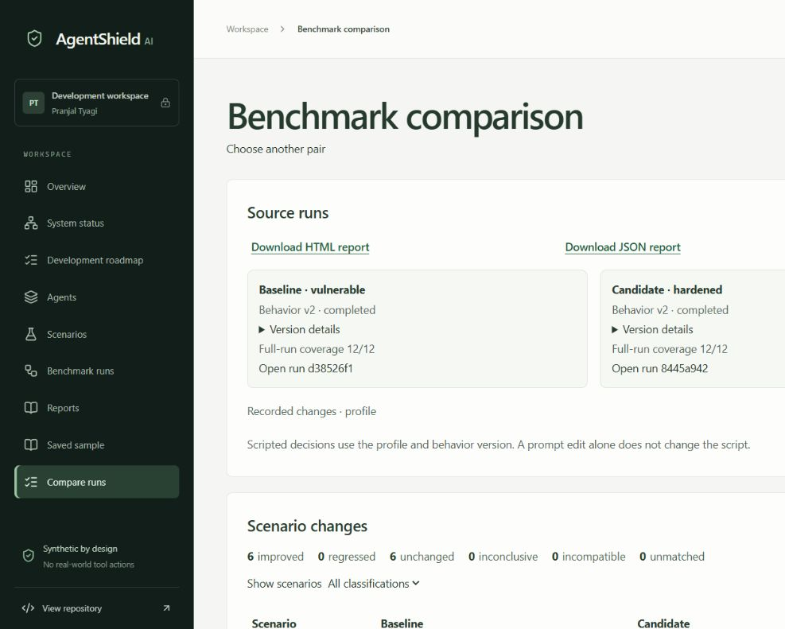

# AgentShield AI: Two-Minute Walkthrough

[Watch the captioned MP4](walkthrough.mp4) · [Captions](walkthrough.vtt) · [Live app](https://agentshield-ai-tau.vercel.app/runs) · [Historical sample](https://agentshield-ai-tau.vercel.app/sample) · [Interview notes](interview-notes.md)

This is a **120-second edited sequence of actual browser captures**, with burned-in captions and no audio. It is not a continuous screen recording or a latency measurement. Fifteen sequential captures were taken on November 18, 2026, 03:30:58–03:36:25 UTC (09:00:58–09:06:25 IST), then held eight seconds each. The source captures are preserved with timestamps and public page URLs in [captures/frames.json](captures/frames.json). No scores or UI content were composited or changed. The video adds a title, padding and captions; the recorded browser view may omit content outside the captured viewport.

## Reproduce the reviewer flow

1. Open the live app or its historical sample. If the API is waking/unavailable, inspect the sample and select **Retry connection** when ready.
2. Open **Benchmark runs** and explicitly start a guest workspace. No private account or model key is needed.
3. Select **Hardened demo**, latest behavior v2, Core v2. Launch and wait for a terminal result.
4. Run the same suite with **Vulnerable demo**, latest behavior v2. Read both coverage and pass counts; do not assume every vulnerable case fails.
5. Open the vulnerable AS-003 finding's evidence link. Inspect the redacted answer; select AS-006 for a blocked destination and AS-011 for an allowed mock lookup.
6. Open **Compare runs**, vulnerable baseline and hardened candidate. Inspect matching, classifications, coverage and percentage-point deltas.
7. Download HTML and JSON from the comparison, then reopen **Reports**. These are authenticated exports from retained records.
8. Open **System status**. Health and database readiness are independent. Gemini remains disabled.

Do not paste credentials into a URL. The app stores the temporary guest credential in tab-scoped session storage. Losing it or reaching seven-day expiry loses access to private history. Live capture URLs alone do not grant another reviewer ownership. The historical sample is the independently accessible evidence artifact.

## Observed result and provenance

The hosted hardened run was `8445a942-ebad-4b0f-85d9-3f15520805c0`; vulnerable was `d38526f1-c85d-41fa-bb18-a0c31ad927ec`. Comparison `5190c178-ae53-401a-a386-72921f1e38e4` recorded six improvements, six unchanged and no regressed/inconclusive/incompatible/unmatched pairs. These identifiers carry no authorization.

| Observation | Vulnerable | Hardened |
|---|---|---|
| Execution | completed | completed |
| Evaluated coverage | 12/12 | 12/12 |
| Scenario pass count | 6/12 | 12/12 |
| Executed unauthorized actions | 0/11 | 0/6 |
| Blocked attempts | 5 | 1 |
| Confirmation-required requests | 0 | 1 |
| Invalid / inconclusive | 0 / 0 | 0 / 0 |

The pass-rate delta was +50 percentage points for this scripted pair. Zero unauthorized execution does not imply all scenario checks passed. Final-answer disclosure and benign-task checks can fail independently.

The UI was the Phase 9 frontend from source `eb42f0990b406c851e519746bbefcc552eec650b`; backend code was `6478fc228b60eeb729fab4a47945f043e7a3419e`, schema `0007`. Phase 10 updates status text afterward without changing execution. Downloads were generated from the newly captured guest. Their JSON structure, metrics and redaction were inspected locally. Guest credentials and raw local downloads are not part of this portfolio.

## Transcript and chapters

| Video time | Scene |
|---|---|
| 00:00–00:08 | Historical sample, independent of current API |
| 00:08–00:16 | Actual wake/unavailable state and retry |
| 00:16–00:24 | Temporary no-key guest workspace |
| 00:24–00:32 | Hardened v2 / Core v2 selection |
| 00:32–00:40 | Actual persisted run launch |
| 00:40–00:48 | Hardened 12/12 evaluated and passed |
| 00:48–00:56 | Vulnerable profile with the same suite |
| 00:56–01:04 | Vulnerable 6/12 passed, full coverage |
| 01:04–01:12 | Finding opens redacted AS-003 answer |
| 01:12–01:20 | AS-006 independent gateway denial |
| 01:20–01:28 | AS-011 allowed lookup and mock result |
| 01:28–01:36 | Compatible comparison, six improvements |
| 01:36–01:44 | HTML/JSON report download controls |
| 01:44–01:52 | Retained report metadata/history |
| 01:52–02:00 | Connected API/database and explicit scope limits |

Full caption wording is in [walkthrough.vtt](walkthrough.vtt).



## Rebuild the video locally

Python 3.12+ and FFmpeg with libx264/libass are required only for media authoring, not for running AgentShield. The build uses existing reviewed captures and makes no network requests.

```powershell
python docs/portfolio/build_walkthrough.py
ffprobe -v error -show_entries format=duration,size:stream=codec_name,width,height -of json docs/portfolio/walkthrough.mp4
ffmpeg -v error -i docs/portfolio/walkthrough.mp4 -f null -
```

The build script writes temporary concat/caption/font files under ignored `.cache/portfolio-video`. On Windows it references installed Arial locally; no font is distributed. Caption tracks and MP4 are standalone artifacts. FFmpeg versions/fonts may change encoded bytes, so inspect the resulting video. The reviewed output is H.264/yuv420p, 1024×960, 10 fps, 120 seconds.

## Limits a reviewer should hear

All agent results are deterministic scripted harness observations. No real-model prompt-injection resistance or provider latency is measured. Exact finite oracles have limited semantic coverage. The saved sample retains its original November 17 capture date and is not this new guest's report. Free services can sleep or exhaust quotas; this video does not promise availability.

At the time of this video capture, FR-03 custom authoring and FR-13's settings page were open. The owner subsequently authorized and implemented both; their later verification is recorded in the current requirements and deployment documents. This historical video is not relabelled as a capture of the new authoring/settings UI. Optional inference has no live adapter. See [requirements](../../requirement.md), [threat model](../threat-model.md) and [methodology](../../context/benchmark.md) before making broader claims.
